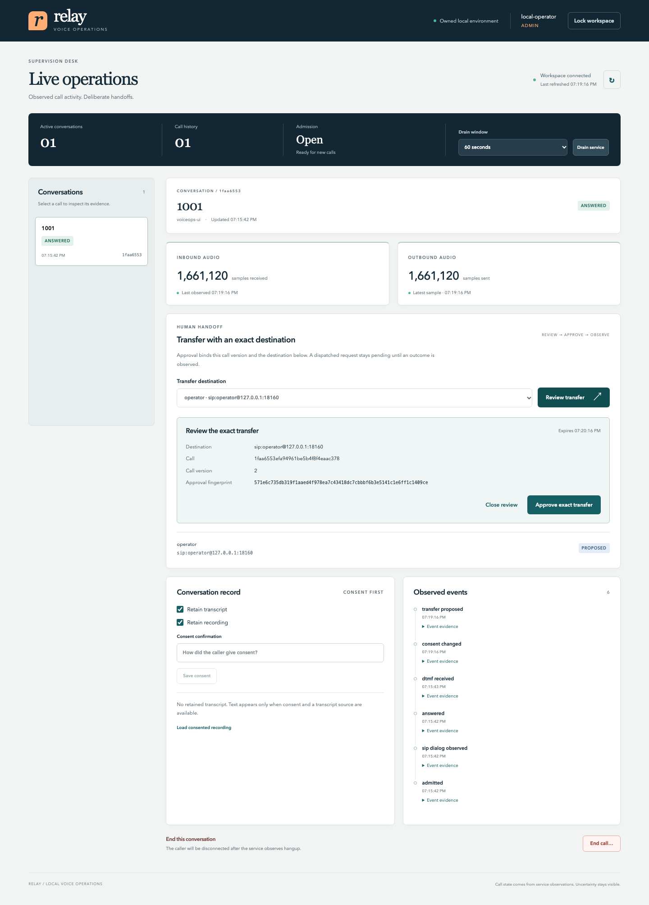

# Relay — Realtime Voice Operations

Supervise a local SIP intake call, inspect its media and consent, and approve one exact handoff. Relay keeps a transfer unresolved until a second dialog and bidirectional audio establish its outcome.



The application includes a Python ledger/control API, React console, LiveKit room/SIP services, Redis, Asterisk and actual SIP phone fixtures. Optional local speech uses Whisper, Qwen and eSpeak through LiveKit Agents. The reference worker handles one call in one private room.

## Run locally

The complete media setup was verified on Apple silicon with Docker Desktop, Python3.11.11, Go1.24.2 and pinned codecs. First follow the [runbook](docs/runbook.md) to build the native bridge and phone.

```sh
python3.11 -m venv .venv
. .venv/bin/activate
pip install -e . -r requirements-livekit.lock
npm --prefix frontend ci --ignore-scripts
npm --prefix frontend run build
docker compose up -d --wait
```

Start the native bridge with `--config infra/sip.yaml`. In separate terminals using the Python environment:

```sh
python scripts/demo.py provision
python -m voiceops.worker
python -m voiceops --demo
python scripts/demo.py call --target operator
```

Open **http://127.0.0.1:18170** using the public local fixture key `voiceops-local-operator-demo-key-32characters`. Select the answered call, inspect media/DTMF, review a transfer to **operator**, then approve the displayed URI, call version, digest and expiry. The fixture opens a second SIP dialog, checks audio after the original BYE and records the outcome in the console. The operator destination is an automated echo endpoint; an attended human or PSTN call has not been verified. `--target reject` and `--target unanswered` exercise failures. Each finite fixture closes its calls after the check.

## Implemented behavior

- Persisted admission, session-specific call identity, lifecycle events and version checks.
- Exact expiring approval, cancellation before dispatch, durable intent and no blind transfer retry.
- Real PCMU audio, DTMF, transfer outcomes, repeated callers, draining and crash recovery.
- Separate transcript/recording consent, consent-generation fencing, bounded audio, authenticated playback and withdrawal deletion.
- Owner-scoped operator/viewer access, bounded HTTP requests and loopback control endpoints.
- Optional speech intake with explicit `*` interrupt/reset and `#` submit; the model has no call-control authority.
- Consistent SQLite snapshots and checksum-verified restore to a new path.

```sh
python -m unittest discover -s tests -v
npm --prefix frontend test
```

The [acceptance report](docs/acceptance.md) separates core tests, actual SIP traffic, model calls and browser checks. Carrier integration, automatic spoken interruption, multi-call capacity and production operation require additional evidence.

[Architecture](docs/architecture.md) · [Operations and backup](docs/runbook.md) · [API](docs/api.md) · [Speech](docs/speech.md) · [SIP fixtures](docs/local-sip.md) · [Dependencies](dependencies/README.md)
