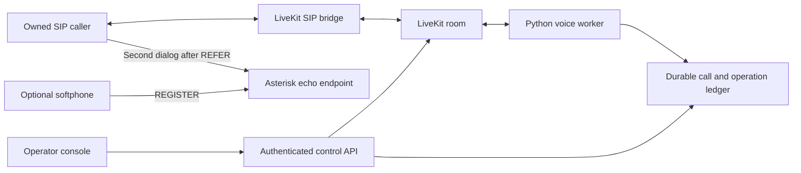

# Architecture and acceptance boundaries

The bridge and room service share Redis. Credentials and recordings are runtime
inputs. An operation response is recorded separately from evidence that a second
endpoint answered and media continued. A lost response becomes an uncertain
outcome and cannot be blindly replayed.

Admission, the call ledger and transfer approvals are application responsibilities.
The signaling layer supplies dialog identifiers, observed call events and media
statistics. A stopped worker can reconcile a call; it cannot resurrect a terminated
SIP dialog. Graceful draining rejects new work while existing calls finish within
a configured deadline.

Core acceptance uses owned local endpoints and actual SIP/RTP traffic. Carrier
connectivity is a separate deployment integration.

The first call goes directly to the authenticated LiveKit SIP trunk. Asterisk is the registrar and second-dialog destination; LiveKit SIP is not a registrar. Redis, LiveKit and Asterisk run in Docker while the bridge/phones run on the host with explicit loopback media addressing.

`CallRegistry` binds reusable phone identities to RTC participant SIDs. Late callbacks cannot retire a new call. Supervisory actions check the recorded SID first; the upstream control API still addresses identities, so the preflight is not an atomic server-side compare-and-swap. Private rooms and one-call admission are required.

Transfer approval binds the call version, URI and digest for sixty seconds. Intent is persisted before dispatch and cannot be claimed twice. API acknowledgement stays pending; lost or overdue observations become uncertain. Only trusted local observers reconcile outcomes. Success requires a second answered dialog and audio in both directions. Rejection restores the original call only with current dialog/media proof. The finite test phone closes after its check, so its final ledger state is ended even when original media survived the failed handoff.

Echo counters describe application RTC frames, not raw network RTP loss. A bridge can supply concealment/silence frames. The verified timeout intentionally stops application output and proves bounded hangup; it is not a raw SIP silence detector. Speech output is intermittent and has a different health policy. Accepted outgoing RTC frames are still distinct from independently verified remote playback.

Consent starts off, separately for transcript and recording. A monotonic revision fences buffered recording audio to the original grant; revoke/regrant cannot persist an old buffer. Withdrawal deletes live retained data. Caller-side PCM recording is mono and limited to sixty seconds, not a full mixed call. Speech necessarily processes bounded audio in memory even when retention is disabled. Models cannot authorize call control.

The worker holds an exclusive ledger lock. A graceful stop closes admission and allows ten seconds before requesting hangup. Unavailable control leaves unresolved state intact; shutdown and cleanup are bounded. Restart reconciles/terminates an orphan, without restoring its inference session. Multi-worker routing, high availability, production IAM/TLS, public carriers, attended human calls and load qualification require further implementation and evidence.
