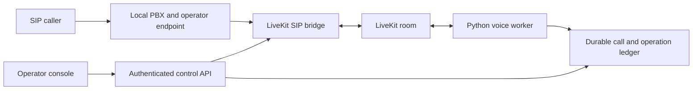

# Architecture and acceptance boundaries

The bridge and room service share Redis. Credentials and recordings are runtime
inputs. An operation response is recorded separately from evidence that a second
endpoint answered and media continued. A lost response becomes an uncertain
outcome and cannot be blindly replayed.

Admission, the call ledger and transfer approvals are application responsibilities.
The signaling layer supplies dialog identifiers, observed call events and media
statistics. A stopped worker can reconcile a call; it cannot resurrect a terminated
SIP dialog. Graceful draining rejects new work while existing calls finish within
a configured deadline.

Core acceptance uses owned local endpoints and actual SIP/RTP traffic. Carrier
connectivity is a separate deployment integration.
